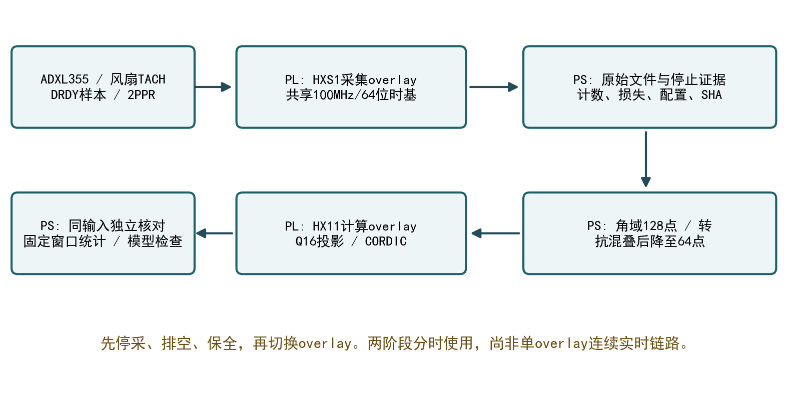

# 系统架构

## PL HXS1采集

ADXL355通过SPI提供XYZ。共享100MHz、64位时基记录被接受的DRDY样本与TACH边沿；样本FIFO4096、脉冲FIFO256。PS排空后保全CSV、metadata与只读停止旁证。

实际转速源为风扇原生2PPR TACH。隔一个同极性边沿确定一转；历史1PPR注记保留原字节，分析显式按实际来源解释。

## PS角域准备

主协议Z轴、8×128圈。每转插值128点，整窗低通后降至64点：24阶以下通带、24—32阶余弦过渡、32阶及以上置零。每窗8192字，8窗65536字。

[角域准备](../sim/golden/prepare_tach_order1x.py)与[抗混叠](../sim/golden/angle_antialias.py)在PS执行。后级低通不能恢复前级已混叠的信号。

## PL HX11计算

[1×核心](../build/rtl/order1x_core.v)使用Q16正余弦投影，包括[累加器](../build/rtl/order1x_accumulator.v)、[CORDIC](../build/rtl/cordic_vectoring.v)和[AXI接口](../build/rtl/order1x_axi.v)。[驱动](../board/bringup/order1x_accel.py)读取寄存器。

| 量 | 语义 |
|---|---|
| 原始轴量 | signed20，256000 count/g |
| I/Q及幅值 | 原始计数Q8，除65536000得到加速度g |
| 幅值 | 测点所选轴1×峰值，非RMS或总振动 |
| 相位 | BAM32数学编码，绝对物理相位未标定 |

## 生命周期与配重扩展

先停源、处理在途事务、排空并保全，再加载计算overlay；切换后重建对象。封存HXS1 peer与后续同名接口驱动不能随意互换。

核对实际输入身份后，独立求整数I/Q、幅相及显示值。文件、算术、物理解释和应用验收属于不同层次。

[原幅值四状态求解器](../sim/golden/phase_free_balance.py)减少对跨启动绝对相位的依赖，仍要求质量、半径和机械响应条件可信。闭合失败时不生成已验收修正质量。
