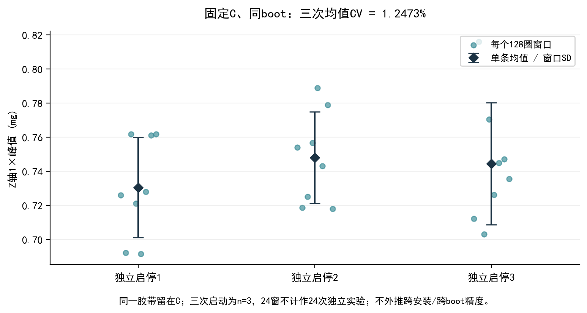
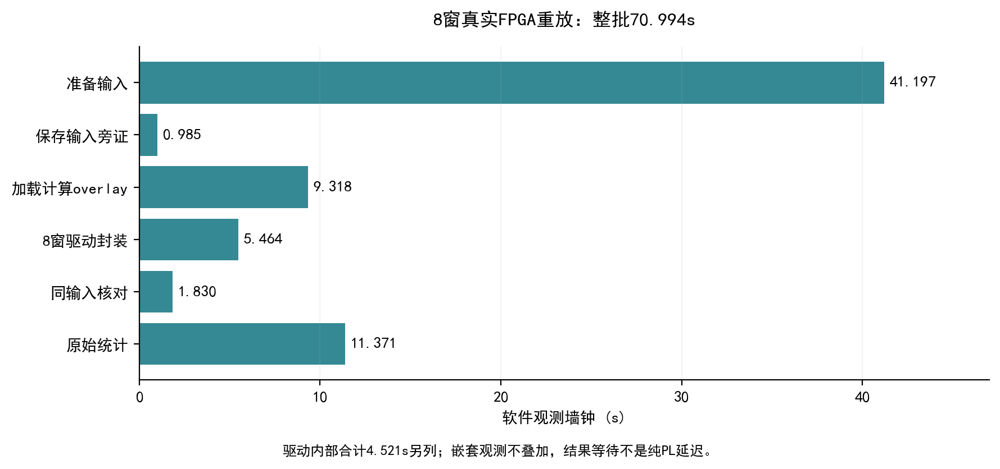

# 实验结果

幅值为所选测点Z轴1×加速度峰值，mg表示千分之一重力加速度。各安装／试重批次分别解释。

## FPGA同输入核对

固定C按采集顺序的第一份记录全部8窗上板。65536字与PC重建一致，整数I/Q精确匹配，幅值寄存器相对舍入参考最大差0 LSB。CPU理想极坐标均值0.730442226mg，FPGA寄存器均值0.730440140mg；差异来自量化语义。

[原始核对](../data/review/hx_fpga_replay_20261101/independent_review.json) · [离线复核脚本](../data/review/hx_fpga_replay_20261101/verify_eight_windows.py)

## 固定C三次启停

| 启停 | 均值mg | 记录内CV | RPM中位 |
|---|---:|---:|---:|
| 1 | 0.730442 | 4.01% | 1713.99 |
| 2 | 0.747913 | 3.60% | 1720.07 |
| 3 | 0.744403 | 4.81% | 1721.55 |

三次均值CV1.2473%，n=3、固定C留胶带、同boot、加固前安装。连续窗不能当作独立启停或校准精度。[独立复核](../data/review/hx_fixed_c_reference_20261101/independent_review.json)

## 模型与参考变化

历史A附近低Z轴1×响应是位置效应线索，复位、安装与运行条件贡献未分离；原四状态闭合约29.77%未通过。

加固后五状态首尾无试重+41.3232%，预定首基线闭合44.5787%，同窗时间域拟合仍约44.30%。后基线代入约9.81%只作诊断，未替换主基线放行。[五状态核对](../data/review/hx_control_result_20261101/independent_review.json)

## 11月2日B0—A—B1

| 状态 | 均值mg | 窗口SD mg | 记录内CV | RPM中位 |
|---|---:|---:|---:|---:|
| 无胶带前B0 | 0.539168 | 0.016015 | 2.97% | 1714.26 |
| A胶带 | 0.527831 | 0.015338 | 2.91% | 1715.84 |
| 取下后B1 | 0.722605 | 0.021967 | 3.04% | 1712.45 |

A相对B0−2.10%，B1相对B0+34.02%。三份同boot、配置读回一致，前后参考未恢复，无法可靠分离胶带净作用；外部环境、安装、热状态及初始化贡献尚未分开。本批来源CPU，没有新增FPGA计算。

保留3份完成和2份中断；中断记录不混入旋转分析。[原件](../data/physical/hx_20261102_001/board_export/reversible_01) · [复核](../data/review/hx_reversible_20261102/independent_review.json)

## 性能与资源

总壁钟70.994秒，准备41.197秒、overlay加载9.318秒、全记录统计11.371秒。驱动内部4.521秒，其中喂数4.517秒。最后输入至软件观察result-valid约39—42微秒，含MMIO与轮询；没有受控基线，不报告整机加速比。

| 历史routed设计 | LUT | FF | BRAM tile | DSP | 时钟 | WNS / WHS ns |
|---|---:|---:|---:|---:|---|---|
| 采集 | 2039 | 2419 | 27.5 | 0 | 100MHz | 0.941 / 0.044 |
| 计算 | 2240 | 1465 | 0 | 2 | 100MHz | 0.718 / 0.061 |

两个设计TNS=0，保留43／6条DRC警告；资源不相加为单一设计。该表记录历史实测匹配版本。[历史报告](../build/reports/historical_20261015)

## 本轮干净硬件构建

| 设计 | LUT | FF | BRAM tile | DSP | WNS ns | WHS ns | DRC警告检查 |
|---|---:|---:|---:|---:|---:|---:|---:|
| acq_sync | 2039 | 2419 | 27.5 | 0 | 0.941 | 0.044 | 42 |
| order1x | 2240 | 1465 | 0 | 2 | 0.718 | 0.061 | 6 |

两套设计均在100MHz下完成综合、实现、位流和XSA生成，TNS/THS均为0。输入Tcl、RTL、PS7配置及采集XDC已与本次源码逐字节核对。新的资源与时序结果不是软件优化前后对照，也不代表新镜像已上板。保留原sealed实测镜像及七文件SHA。

采集报告保留RAMB异步控制警告及外部输入/输出延迟检查，工具日志也保留PS预置只读参数和DDR DQS偏移警告；内部WNS/WHS通过不等于外部接口或DDR完成独立签核。未为减少警告而改动板卡预置、RTL或实物协议。完整原始报告与机器可读来源一并保留。

[原始报告](../build/reports/rebuild_20261102/readme.md) · [输入/输出身份](../verification/hardware_rebuild_20261102.json)
