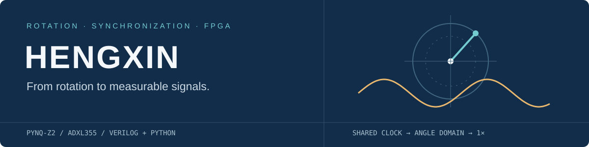
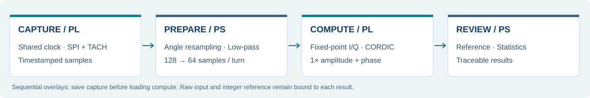

<p align="center"></p>

<h1 align="center">衡芯 · FPGA动平衡仪</h1>
<p align="center">基于 PYNQ-Z2 的转速同步振动测量与动平衡辅助分析</p>
<p align="center">
  
  
  
  <a href="https://github.com/Jaden1717/fpga-dynamic-balancer-2026-public/actions/workflows/validate.yml"></a>
</p>
<p align="center"><a href="docs/quickstart.md">快速开始</a> · <a href="docs/architecture.md">系统架构</a> · <a href="docs/hardware.md">硬件指南</a> · <a href="docs/results.md">实验结果</a> · <a href="report/design_report.md">技术报告</a></p>

衡芯面向小型风扇、电机等旋转设备，将加速度采样与转速事件统一到 FPGA 硬件时基，提取与转速同步的 **1× 振动分量**。系统结合 Python 的数据准备与分析能力，以及 Verilog 定点计算核心，提供从真实采集、阶次分析到试重响应比较的完整实验流程。

## 核心功能

| 同步采集 | 阶次分析 | FPGA计算 | 实验复核 |
|---|---|---|---|
| ADXL355三轴采样与原生TACH共享时间戳 | 角域重采样、抗混叠与Z轴1×提取 | 定点I/Q投影、CORDIC幅相输出 | 同输入参考比对、多窗统计、试重响应分析 |
| 100 MHz · 64位时基 | 128 → 64点/转 | 8窗 · 65,536个输入字 | 原始记录、运行条件与结果可追溯 |

## 系统架构



PYNQ-Z2 的 PL 负责同步采集与定点计算，PS 负责角域准备、文件管理和统计分析。采集与计算使用两个分时加载的 overlay：采集结束并保存数据后，再切换到计算核心。[查看模块划分与接口](docs/architecture.md)

## 快速开始

无需开发板即可运行软件测试并复核已保存的 FPGA 输出。PC 环境使用 Python 3.13：

```bash
git clone https://github.com/Jaden1717/fpga-dynamic-balancer-2026-public.git
cd fpga-dynamic-balancer-2026-public
python -m pip install -r requirements-dev.txt
python -B data/review/hx_fpga_replay_20261101/verify_eight_windows.py
```

预期输出 `8/8 verified`，表示保存的8窗输入、整数I/Q与幅相结果完成离线核对。

```bash
python -B -m pytest -q -p no:cacheprovider --basetemp work/pytest-local tests tools/controlled_trial/test_finish_control.py
```

[虚拟环境与更多示例](docs/quickstart.md) · [接线与Vivado构建](docs/hardware.md) · [板端运行](docs/measurement.md)

## 实验结果

| 验证项目 | 结果 | 测量范围 |
|---|---:|---|
| 真实输入重建 | 65,536 / 65,536字一致 | 一份实测记录的全部8窗 |
| FPGA整数I/Q | 8 / 8窗精确匹配 | 同输入定点算术核对 |
| 幅值寄存器 | 最大差0 LSB | 相对舍入后的整数参考 |
| 固定状态三次启停 | 均值CV 1.2473% | 同一次系统启动、同一安装，n=3 |
| PC批内准备优化 | 13.0757 s → 1.0532 s | 单次Windows PC基线，输入指纹相同 |

上述指标分别描述计算一致性、限定条件下的重复性和软件准备耗时。实验方法、完整数据及适用范围见[实验结果](docs/results.md)与[技术报告](report/design_report.md)。

## 工程目录

| 目录 | 内容 | 入口 |
|---|---|---|
| `build/` | RTL源码、仿真Tcl、约束、Vivado构建与实现报告 | [构建说明](build/readme.md) |
| `board/` | 板端驱动与运行脚本 | [上板说明](board/readme.md) |
| `sim/` | Python参考、角域准备与模型 | [算法模块](sim/golden/readme.md) |
| `tests/` | 回归测试与固定输入样本 | [开发指南](docs/development.md) |
| `data/` | 原始实测、独立复核与性能基线 | [数据索引](data/readme.md) |
| `sealed/` | 与实测匹配的驱动及镜像校验身份 | [版本身份](sealed_manifest.json) |
| `docs/` · `report/` | 使用文档、架构、实验与技术报告 | [文档中心](docs/readme.md) |
| `skill/` | 可复用PYNQ验证工作流 | [技能说明](skill/readme.md) |
| `tools/` · `verification/` | 复核工具、路径映射与验证记录 | [复现检查](docs/development.md) |
| `third_party/` | 外部依赖的固定来源与校验值 | [第三方说明](third_party_notices.md) |

目录对照：指南中的 `src/` 对应本仓库的 `build/rtl/`、`board/` 和 `sim/golden/`；硬件实现报告位于 `build/reports/`，上板实测输出位于 `data/physical/`。生成的工程、缓存与个人运行结果不纳入版本控制。

## 文档与复用

- [技术报告](report/design_report.md)：原理、接口、优化过程与实验分析。
- [AI协作案例](docs/ai_collaboration.md)：提示词、实际回答与纠错轨迹。
- [PYNQ技能包](skill/readme.md)：采集保全、输入绑定与独立核对方法。
- [贡献指南](contributing.md)：开发环境、验证命令与变更规范。

## 许可

团队原创代码与文档采用 [MIT 许可证](license)。第三方依赖遵循各自条款。详见[许可说明](docs/licensing.md)和[第三方来源](third_party_notices.md)。
