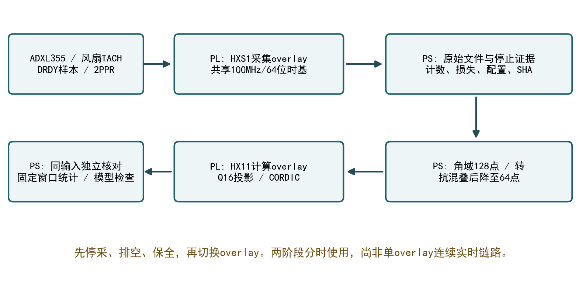
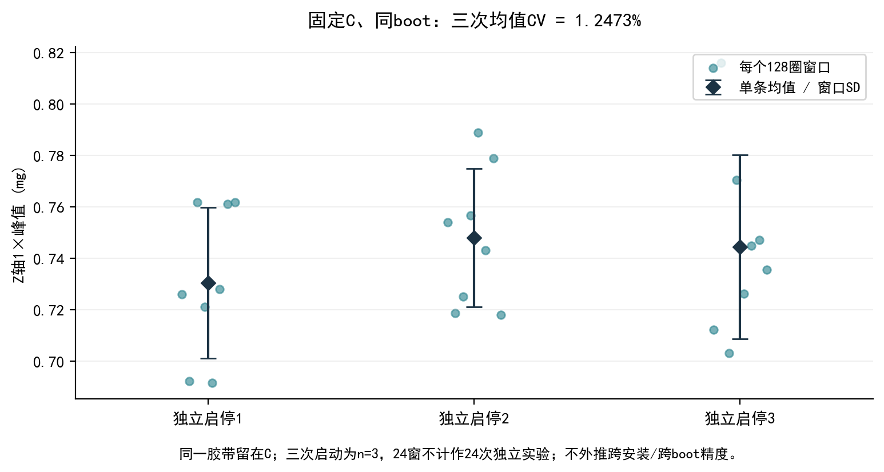
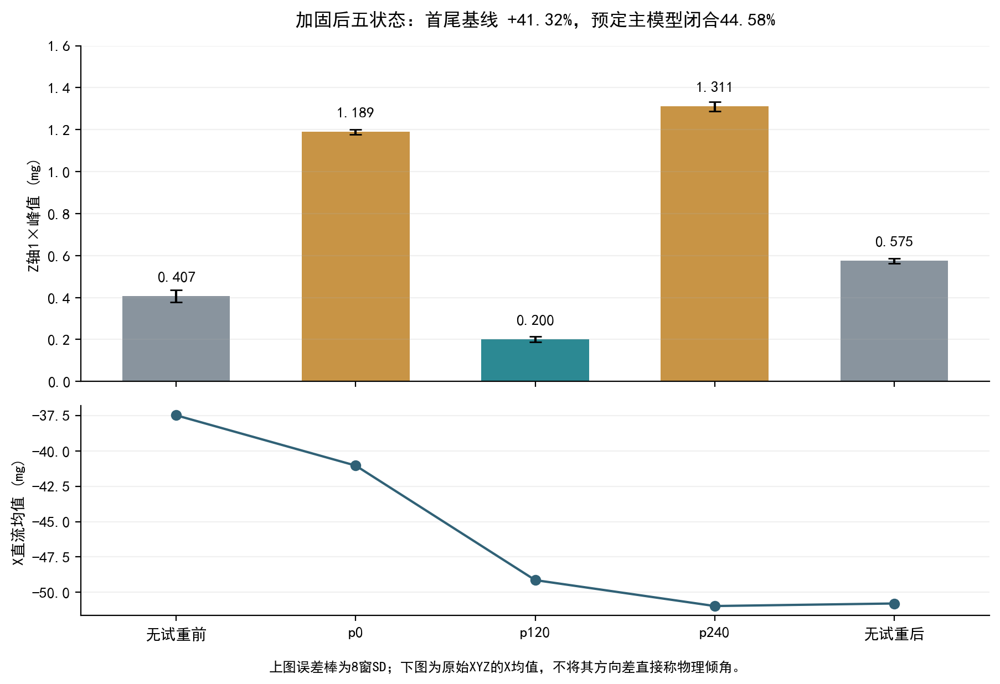
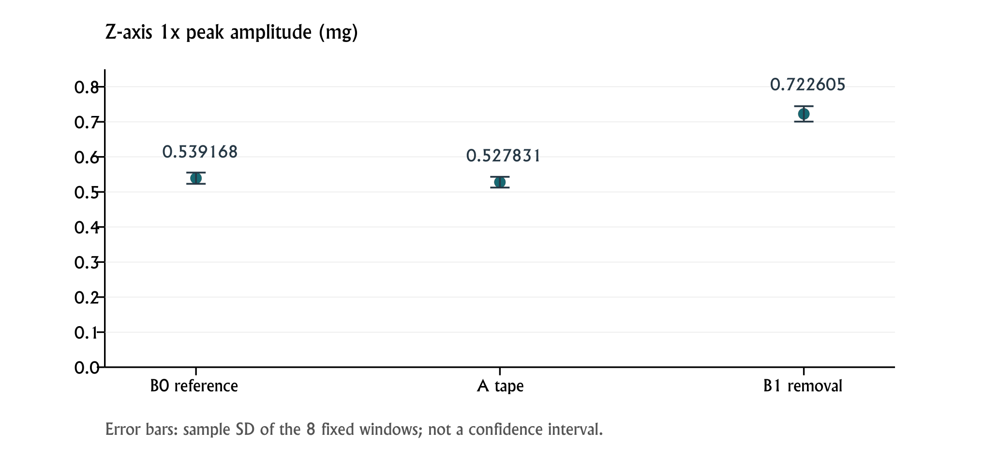
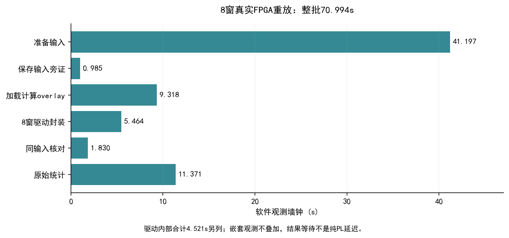

# 衡芯——FPGA动平衡仪

转速同步振动测量与动平衡辅助分析系统 · 技术报告

工程版本：2026-11-02。本文为仓库技术正文。竞赛提交版已按正式模板定稿并导出PDF，版本说明见[报告索引](readme.md)。

[快速开始](../docs/quickstart.md) · [系统架构](../docs/architecture.md) · [实验数据](../docs/evidence.md) · [AI协作记录](../docs/ai_collaboration.md)

## 摘要

小型旋转设备的质量偏心会引起与转速同步的激励，但实际测点振动还受到安装、结构传递、运行历史和环境等因素影响。为建立可复核的测量与计算流程，我们基于AMD PYNQ-Z2、ADXL355加速度传感器与风扇原生TACH，构建转速同步振动测量及动平衡辅助分析原型。PL以100 MHz共享64位时基记录振动样本和转速事件，PS保存原始记录并完成2脉冲每转解释、角域插值、128点至64点抗混叠降采样及整数输入准备，再分时加载计算overlay，由FPGA执行定点1×投影与幅相输出。

一份真实记录的全部8个窗口共65536个输入字与PC重建一致，整数I/Q逐窗精确匹配，幅值寄存器相对舍入参考的最大差为0 LSB。固定C位置、同一次系统启动的三次独立风扇启停，均值样本CV为1.2473%。软件批内共享准备的一次Windows PC基线观察中，CSV解析由17次减为1次，耗时由13.0757秒降至1.0532秒，8窗完整输入指纹保持相同。当前实现采用采集与计算两个分时overlay，不能将这些结果表述为连续实时XYZ处理、整机加速比或传感器精度认证。

试重实验揭示了跨记录参考变化：11月2日无胶带前、A位置胶带、取下后的Z轴1×峰值均值分别为0.539168、0.527831和0.722605 mg。前后参考没有恢复，现有数据不足以可靠识别胶带净作用。原幅值四状态模型保留实现及失败判据，本次不提供已验收的配重克数或最优角度。项目的主要工程成果是共享时基采集、明确的软硬件接口、同输入定点核对、可追溯数据与有适用边界的实验评估流程。

关键词 转速同步测量  FPGA定点计算  可追溯实验验证

## 1 选题背景与设计目标

### 1.1 实际问题

风扇和小型电机的转子偏心会产生随转速变化的周期激励。单平面不平衡量可用质量与偏心半径的乘积描述，理想离心激励的幅值与转速角频率的平方有关。传感器测到的是安装位置和结构传递作用后的加速度响应，不能把某一测点的1×加速度直接当作转子不平衡质量。

$$F_u=m r\omega^2$$

式中m为偏心质量，r为偏心半径，ω为转速角频率。实际响应还需考虑结构传递、测轴方向及其它同步激励。本文利用这个关系解释试重方法的前提，不据此从单个加速度读数直接反算克数。

手持读数或一次贴胶带前后的标量比较容易受到三类问题干扰。首先，振动样本和转速事件可能没有共同的时间依据；其次，软件与硬件可能使用不同窗口或舍入规则；最后，单条记录内波动较小，仍不能保证前后两条记录处于可比较的物理条件。衡芯围绕这三类问题组织工程与实验。

### 1.2 相关工作与本项目的位置

PYNQ官方框架把可编程逻辑封装为overlay，由Python接口组织处理器与逻辑侧的数据流，适合快速实现Zynq软硬协同原型。本项目使用其overlay加载和MMIO能力，但没有将“采用PYNQ”本身写成新的测量原理。[R02]

公开rotorbalancer工程围绕转子测量与平衡组织硬件和软件资料，可作为原始测量、参考信号及结果组织方式的相关参考。ROSS则提供Python转子动力学分析工具，说明结构模型与不平衡响应可以作为独立研究方向。我们未用这些项目的结果代替本机标定或精度证据，也未直接复制其配重实现。[R03][R04]

| 参考方向 | 可借鉴内容 | 本项目的取舍 |
|---|---|---|
| PYNQ框架 | Python组织PS与PL及overlay复用 | 采用分时overlay和明确的驱动生命周期 |
| 开放转子测量工程 | 测量记录与试重过程的组织 | 保留原件与参考变化 另行核对模型 |
| 转子动力学仿真 | 结构响应与不平衡激励建模 | 未知支架参数时 不用仿真替代实物校准 |
| 单平面试重方法 | 通过响应变化识别修正关系 | 保留幅值四状态法 并检查适用前提 |

本项目的价值集中在工程集成与证据完整性：PL统一时间戳，PS明确承担抗混叠准备，计算核心与独立整数参考严格使用同一输入，物理条件和算法计算结果分别描述。已有数据也显示，这种流程能够发现“算术通过但应用模型不满足”的情况。

### 1.3 原始目标与本次交付范围

原始应用目标是通过试重求出可信的单平面修正质量和角度，再通过独立同期测量验证减振。实现这一目标的前提包括采集可靠、算术一致、试重质量和几何可信、响应条件稳定以及独立验收充分。

当前已经建立同步采集、1×分析、真实输入FPGA核对和固定状态短期启停证据。试重模型仍受前后参考变化影响，绝对试重质量也没有形成可用于执行配重的充分证据。因此本次交付主线收敛为可运行、可追溯、可解释的测量与动平衡辅助分析。辅助分析具体包含响应对比、统计描述、参考变化和原模型适用性检查。

| 能力 | 当前状态 | 允许的结论 |
|---|---|---|
| 真实加速度与转速事件采集 | 已有实物记录 | 对应记录的数据与停止状态可核查 |
| 转速与Z轴1×分析 | 已实现并复算 | 在固定协议下给出峰值和描述性统计 |
| FPGA定点计算 | 真实8窗核对通过 | 同输入整数算术一致 |
| 同状态短期重复性 | 固定C三次启停 | 只覆盖该安装和同boot条件 |
| 定量配重与独立减振 | 尚未验收 | 不输出已通过的质量 角度或减振率 |

## 2 系统需求与数据契约

### 2.1 功能需求

系统需要在一个共享时基下保留加速度样本和TACH事件，能够区分正常完成、静止检查和中断记录；需要由固定的窗口协议准备输入，使软件和硬件比较不会受到换窗或不同估计器的干扰；需要保留来源、运行条件、停止状态和结果，使他人可以从原件复核到统计摘要。

对于配重扩展，系统还应在质量未知、几何条件不适定、响应不显著或模型闭合不满足时保留拒绝信息。生成有限数字不能自动授权机械实施，软件结果也不等于已经完成修正后的实物验收。

### 2.2 主分析协议

| 项目 | 当前采用值 | 说明 |
|---|---|---|
| 主轴 | Z | 不按某一批低CV或低幅值临时换轴 |
| 转速源 | 风扇原生TACH 2PPR | 每转两个同极性脉冲 |
| 原始采集时间 | 40秒 | 与现有约1700RPM工况相配 |
| 分析窗口 | 8个128圈窗口 | 从0 128 256 384 512 640 768 896圈开始 |
| 角域准备 | 128点每转至64点每转 | 降采样前先低通 |
| 单窗输入 | 8192个signed20整数 | 128乘64 |
| 全批输入 | 65536字 | 全部8窗保留 |
| 默认幅值来源 | CPU reference | 显式执行计算overlay后才形成新FPGA证据 |

该协议不是任意转子量程说明。换转速、传感器或安装后，应重新界定采集时长、可用完整圈数、幅值解释和模型前提。40秒采集前的30秒等待只是实际操作协议，不作为已证明热稳态的依据。

### 2.3 单位与统计量

原始轴量按256000 count/g换算。这里g是重力加速度单位，mg是其千分之一；配重质量中的g表示克，两个量必须在表头和正文中写清。当前幅值是所选测点Z轴的1×相干峰值，不是RMS、峰峰值或三轴宽带总振动。

记录内8个窗口的SD和CV描述该条记录内部离散；三次独立启停均值的SD和CV描述三个运行均值之间的离散。两者的统计样本单位不同，连续窗也可能相关，不能把8个窗当作8次独立启停，或直接由SD除以根号8给出整机精度保证。

## 3 硬件系统与软硬件划分

### 3.1 实物组成

系统采用PYNQ-Z2，器件为xc7z020clg400-1；加速度输入为ADXL355及其评估模块，风扇为NF-P12 redux-1700。ADXL355提供20位数字输出并支持SPI，器件分辨率本身不代表整机精度。传感器安装、线缆受力、结构传递和工作条件仍会影响实际测量。[R01]

风扇使用原生TACH，不采用旧文稿中的光电单脉冲解释。TACH为开集电极输出，历史接线记录为4.7k电阻上拉至3.3V。风扇独立约12V供电并与板卡共地，软件没有控制风扇电源。

| 信号 | Pmod接口 | FPGA引脚 | 约定 |
|---|---|---|---|
| ADXL355片选 | JA1 | Y18 | SPI |
| MOSI | JA2 | Y19 | SPI |
| MISO | JA3 | Y16 | SPI |
| SCLK | JA4 | Y17 | SPI |
| DRDY | JA10 | W19 | 被接受边沿对应样本时间戳 |
| 风扇TACH | JB1 | W14 | 原生2PPR及3.3V上拉 |

图1 实际采用的PS与PL分工



图2 历史实物原型供说明组成


历史原型照片保存在竞赛归档中。第3部分的构型与安装说明分别对应相关历史批次。

### 3.2 划分依据

PL负责需要明确事件顺序和确定接口行为的部分：SPI采集、共享时间戳、FIFO记录和定点1×核心。PS负责较灵活且需要文件管理的部分：采集编排、停止检查、角域准备、抗混叠、结果核对、统计和报告。

选择分时overlay使采集与计算工程可以分别验证，并保留已有匹配镜像和驱动。代价是切换开销与PS准备时间，当前不能形成单一overlay的连续实时XYZ链路。本文将这一取舍作为实际架构说明，不把阶段性实现描述成尚未验证的集成方案。

| 层次 | 主要职责 | 当前实现 |
|---|---|---|
| PL采集 | SPI 时基 事件记录 FIFO | HXS1采集overlay |
| PS准备 | 原件保全 转速解释 角域抗混叠 量化 | Python与NumPy |
| PL计算 | 定点1×投影 CORDIC及结果寄存器 | HX11计算overlay |
| PS评估 | 独立参考 来源核对 统计与模型筛查 | review与compare入口 |

### 3.3 版本与生命周期

历史HXS1采集使用sealed/capture_peer中的两份精确peer驱动与本地匹配的acq_sync.xsa，停止观察器在sealed/stop_evidence。历史计算使用本地匹配的order1x.xsa和board/bringup/order1x_accel.py。封存清单保存七份文件的SHA256。

采集完成后必须先停源、处理在途数据、排空FIFO并保全原件，然后才能加载计算overlay。切换后重建Overlay、驱动及MMIO对象，不访问旧对象。后续开发目录中同名sync_capture.py属于不同接口演进，不能直接替换封存peer来配旧XSA。

## 4 共享时基采集与接口设计

### 4.1 共享计数器与记录

HXS1以100 MHz自由运行的64位计数器作为共同时间依据。采集记录包含被接受的DRDY样本时间戳和TACH边沿时间戳。样本FIFO深度4096，脉冲FIFO深度256；PS交替排空两个队列，减少持续样本流使低速转速事件长期得不到服务的风险。

样本记录保存frame_id、ticks、x_raw、y_raw、z_raw；转速事件保存pulse_count与ticks。时间由硬件计数差换算，而不使用Python读取时刻重建。64位回绕按模数处理，先进行整数计数差，再转换浮点时间，避免过大绝对tick直接转浮点造成精度损失。

$$t_i=\frac{c_i-c_0}{f_c},\qquad f_c=100\times10^6\ \mathrm{Hz}$$

该式仅表示同一有效epoch内的正常前向差值；跨64位回绕时使用模数展开。不同采集初始化与不同系统启动的身份另外记录，不把文件创建时间作为采集时基。

### 4.2 采集端接口契约

| 对象 | 契约 | 目的 |
|---|---|---|
| 身份 | HXS1 magic为0x48585331 ABI为0x00010000 | 拒绝不匹配镜像 |
| FIFO头 | 读取期间保持至显式POP | 多寄存器读取组成同一记录 |
| 样本连续性 | cleared epoch首frame为0 后续递增 | 检查缺失或重复 |
| 脉冲连续性 | 首pulse计数为1 后续递增 | 检查事件记录连续性 |
| 时间顺序 | 模数展开后严格前向 | 拒绝反向或重复时间 |
| 数值范围 | XYZ在signed20范围 | 拒绝坏码与错误解释 |
| 损失 | sample_drops pulse_drops source_missed保留 | 不能只看CSV行数 |

采集入口额外读取DEVID、FILTER、RANGE与POWER_CTL，当前历史读回为0xAD、0x00、0x81和0x00。回读发生在原configure完成且源尚未启用时，不增加新的传感器配置写入。每次capture仍会执行原配置与reset，所以同boot并不能证明零偏、初始化状态或热条件完全相同。

### 4.3 停止与失败处理

正常结束时先关闭采集源，等待在途SPI及发布事务完成，再冻结捕获并排空FIFO，读取停止快照。检查包括源idle、FIFO空、epoch一致、源计数和末XYZ与原文件一致，以及损失和溢出标记。实时DRDY等状态位与冻结计数分开解释，不能因实时引脚发生变化就认定原件失效。

手动中断和错误也进入停止与保全路径。程序保留部分原件及错误状态，返回非零，不自动重试。输出目录已存在时拒绝覆盖。静止检查必须显式允许无脉冲，其结果为STATIC_ONLY，不能生成旋转分析结论。

## 5 转速同步分析与抗混叠

### 5.1 原生2PPR的解释

风扇每转产生两个同极性TACH脉冲，因此相邻两个脉冲通常只对应半转；我们隔一个边沿取完整一转。设第k和第k+2个有效边沿的tick分别为e_k与e_k+2，转速定义为：

$$n_k=\frac{60 f_c}{e_{k+2}-e_k}\quad\mathrm{RPM}$$

完整一转的取边方式避免将2PPR直接解释成两倍转速。半转间隔不完全相等时，也不能直接把其差异全当作转速波动。原生双脉冲缺少唯一的转子绝对零位，数学phase_deg不能自动用于跨独立启动的复数影响系数配重。

### 5.2 角域重采样

在每个完整转周期中，依据共同时间轴对原始轴数据进行线性插值，先得到128点每转的稠密角域序列。转速不是绝对恒定时，这一步把单纯按时间等间隔的样本映射到按角度等间隔的网格，使同频于转速的1×分量在角域中具有固定周期。

当前窗口固定为128圈，整窗共16384个128点网格样本。全部8个预定窗口从起始圈按顺序处理，没有按幅值、CV或模型闭合挑选窗口。XYZ原始数据都保留，但主结果按事先固定Z轴计算。

### 5.3 降采样前低通

稠密角域序列经整窗频域低通后保留偶数位置，降至64点每转。通带截至24阶，24至32阶采用余弦过渡，32阶及以上置零。这里的阶次为频率相对于转速的倍数，64点每转的角域奈奎斯特阶次为32。

$$H(o)=\begin{cases}1,&|o|\leq24\\\tfrac12\left[1+\cos\left(\pi\frac{|o|-24}{8}\right)\right],&24<|o|<32\\0,&|o|\geq32\end{cases}$$

该处理把整窗视为周期延拓，是PS侧的离线零相位操作，不是已在FPGA实现的因果滤波器，也不提供物理相位标定。它控制本次128至64降采样的折叠，不能消除ADC、前级采样或128点插值中已经产生的混叠。

### 5.4 量化与输入保全

低通后的角域值四舍五入为原始计数整数，半数远离零，并检查signed20范围。每份准备输入保存所用轴、窗口起止tick、圈数、量化约定、原始文件SHA和实际整数列表。FPGA比较必须使用这些准备字，不能拿另一个时间窗或另一种拟合器的结果当作同输入参考。

## 6 FPGA定点一倍频核心

### 6.1 投影与归一化

设每转64个角域输入，窗口圈数为R，总样本N等于64R。理想相干峰值复系数按下式定义，虚部采用负正弦约定：

$$C=\frac{2}{N}\sum_{k=0}^{N-1}x_k\exp\left(-j\frac{2\pi k}{64}\right),\qquad A=|C|$$

式中x若使用原始计数，C也是原始计数峰值；物理换算见下一节。硬件使用Q16正余弦常数和signed20输入。一个四分之一波表通过反射和符号扩展形成64个相位，正负相位保持对称。输入握手推进角度索引与剩余样本计数；乘法流水线携带valid和last标记，防止最后一个乘积遗漏或计数提前结束。

当前RTL以20乘18位有符号乘法生成两路乘积，各映射一个DSP48E1；实部与虚部使用52位累加寄存器。最终按13加avg_log2右移并作有符号半数远离零舍入。主协议avg_log2为7，右移20位，输出为原始计数Q8。

$$I_{q8}=\operatorname{sgn}(P_I)\left\lfloor\frac{|P_I|+2^{s-1}}{2^s}\right\rfloor,\qquad s=13+\log_2R$$

虚部采用同一归一化规则。独立软件参考直接根据数学常数求和，不依赖RTL四分之一波表case内容，从而降低共用同一错误实现导致误通过的风险。

### 6.2 极坐标与单位

I/Q送入CORDIC获得幅值与相位。核对顺序先检查整数I/Q，再比较幅值寄存器与理想极坐标舍入参考。CPU理想幅值由整数I/Q求模，FPGA显示幅值由实际幅值寄存器派生，两者的量化语义分别保留。

$$A_g=\frac{M_{q8}}{256000\times256},\qquad \phi_{deg}=\frac{p_{BAM32}\,360}{2^{32}}$$

相位码为signed32 BAM32，零向量的相位另有有效标记。极小相位数值差只表示编码与算术核对，不代表传感器、结构或转子零位的物理相位精度。

### 6.3 计算端ABI

| 偏移 | 寄存器 | 当前用途 |
|---|---|---|
| 0x00 0x04 | MAGIC VERSION | HX11为0x48583131 ABI为0x00010000 |
| 0x08 | CTRL | CLEAR与START |
| 0x0C | STATUS | busy input ready result valid phase valid及错误状态 |
| 0x10 | AVG_LOG2 | 0至8 对应1至256圈 |
| 0x14 | INPUT | 写入完整signed20输入字 |
| 0x18 0x1C | ACCEPTED EXPECTED | 实际与预期输入计数 |
| 0x20 0x24 | REAL_Q8 IMAG_Q8 | 两路有符号投影结果 |
| 0x28 0x2C | MAG_Q8 PHASE | 幅值与BAM32相位 |
| 0x30 | ACK | 结果读取完成后确认 |
| 0x34 0x38 | CYCLES ERROR_CODE | 含喂数空隙的周期计数及错误码 |

驱动先验证输入数量、范围和超时参数，再CLEAR、设置圈数、START，逐字等待输入就绪并喂入。结果有效后，在ACK前一次性读取计数和结果寄存器；计数不一致或硬件错误会拒绝成功结果。异常和中断时尝试CLEAR并保留原始错误，不把部分结果当完成。

AXI定向测试覆盖地址与数据到达次序、WSTRB、响应反压、CLEAR和ACK等行为。已有定向覆盖不等于任意AXI序列的协议认证，也不替代板级实际运行。

## 7 软件流程与证据管理

### 7.1 统一入口

measurement_run.py提供capture、review和compare三个入口。capture编排实际采集、原件与停止保全以及分析；review对已冻结原件重新准备全部预定窗口，可选择显式加载计算overlay；compare筛查两条同状态摘要的记录条件。默认分析先给CPU参考，只有确实执行FPGA并保存对应结果时才标为新硬件计算。

入口固定使用已确认的PYNQ虚拟环境，解决sudo调用系统Python而找不到pynq的问题。板端脚本在解释器不存在时失败退出，不自动回退到另一套环境。输出目录存在时拒绝覆盖，异常保留run状态和已生成文件，CV变化不触发自动重采。

### 7.2 文件之间的关系

| 文件 | 保存内容 | 使用边界 |
|---|---|---|
| samples.csv | frame tick及XYZ原始整数 | 冻结后不改内容 |
| pulses.csv | TACH计数与tick | 实际2PPR解释在分析入口声明 |
| capture.json | 时基 epoch计数 损失 完成状态 | 不回填当时未观察的配置 |
| stop_snapshot.json | 停止旁证及原文件绑定 | 检查源与FIFO状态 |
| runtime.json | boot uptime Python 驱动 初始化 配置及声明 | 保存在raw外 历史缺失保持缺失 |
| input result verification | 实际准备字 硬件寄存器 同输入核对 | 三者共同绑定来源 |
| summary与比较结果 | 全窗幅值 SD CV RPM和条件筛查 | 由已验证量派生 不替代原件 |

配置读回是机器观察；安装、试重和供电方式可能是操作者声明，两类来源分别保留。不同boot是运行上下文差异，不足以独自解释某个幅值变化。同boot也不排除每次初始化、零偏、热状态或安装条件变化。

### 7.3 可比较性标签

比较器根据协议、实现身份、原件、boot、配置和声明给出NOT_COMPARABLE、UNKNOWN或DECLARED_CONDITIONS_MATCH。最后一种只说明所检查字段和声明匹配，不认证物理条件。缺少量化RPM容差或现场信息时保留UNKNOWN，不为获得MATCH而补造历史字段。

当前compare用于同试重状态、同启动批次的条件筛查，不能将不同试重角度简单当作同状态重复。幅值差、绝对SD和CV都保留，阈值来源和用途应在实验前说明。

### 7.4 四层证据

| 层次 | 需要回答的问题 | 当前例子 |
|---|---|---|
| 文件与传输 | 收到的是否为同一份原件 | 归档及文件SHA一致 |
| 同输入算术 | 软硬件是否计算同一组字 | 8窗I/Q精确一致 |
| 物理解释 | 测量是否支持当前比较 | 固定C短期接近 试重参考变化仍存在 |
| 应用目标 | 修正是否经独立验证有效 | 当前尚未完成 |

前一层通过不能自动推出后一层。本项目把这四层作为解释与交付原则，避免将文件校验、定点数值或低CV分别包装成最终动平衡通过。

## 8 动平衡辅助模型与拒绝条件

### 8.1 幅值四状态关系

令B为无试重时所选测点的复数1×响应，T为同一试重位于声明零位时增加的响应。若传递与运行状态在各次记录间保持可解释的线性关系，角度θ的响应为B加T乘以旋转因子。仅测幅值时可建立：

$$A(\theta)^2-A_0^2=Q+X\cos\theta+Y\sin\theta$$

其中Q为试重响应幅值平方，X与Y表示基线和试重响应的交叉项。使用无试重及同一试重三个声明角度的幅值，可解出Q、X、Y；这与直接对幅值作线性向量相加不同。

### 8.2 闭合与质量向量

理想前提成立时，解应满足下式。实现用等式两侧较大值作归一化分母，并用极小正数避免零分母；零基线的数值特殊情况在代码中另行处理。

$$X^2+Y^2=4 A_0^2Q,\qquad \varepsilon_c=\frac{|X^2+Y^2-4A_0^2Q|}{\max(X^2+Y^2,4A_0^2Q,\delta)}$$

当试重质量m_t可信、所有前提通过且修正沿同一半径实施时，代码所用复数质量向量为：

$$\widetilde m_c=-m_t\frac{X+jY}{2Q}$$

向量模给出质量，辐角按同一观察面、转子零位与正方向解释。当前接口返回与试重相同的半径；本文不把它推广成已实现的任意修正半径接口。

### 8.3 当前筛查与适用边界

几何矩阵条件数大于10、拟合Q非正、基线或试重响应未高于5倍输入uncertainty，以及闭合大于15%时，原求解器拒绝生成可执行修正。这些是暂定工程筛查，不是赛事规定、统计置信界或经校准的仪器标准。uncertainty参数必须有用途依据，不能把记录内SD随意改写成整机不确定度。

实际同一胶带质量目前仍未知，几何为操作者约40mm尺量和角度标记。若安装、试重贴合、气动作用、初始化、热状态或外部响应在记录间变化，四状态的恒定传递假设可能不成立。幅值法消除了某些相位依赖，但没有消除机械和测量条件的要求。

## 9 验证方法与评价指标

### 9.1 软件与接口验证

原工程400项测试由394项主测试和6项受控批次工具测试组成。竞赛工程增加10项交付检查与依赖工具用例，本地410项全部通过，记录见verification/publication_tests.txt。GitHub Actions在Linux和Windows运行同一套入口，最新状态见仓库Actions。

| 类别 | 代表检查 | 不能据此推出的结论 |
|---|---|---|
| CSV与时基 | 初始计数 连续性 回绕 单调与损失标志 | 现场安装或传感器校准完成 |
| 角域准备 | 全窗指纹 批内准备与旧方法一致 量化范围 | 所有变速转子都适用 |
| 定点与幅相 | 解析真值 整数I/Q 极坐标与零向量 | 物理相位已校准 |
| MMIO驱动 | 参数先验证 超时 CLEAR 计数 ACK及错误 | 任意AXI序列认证 |
| 展示一致性 | 寄存器正确但浮点显示被改时应拒绝 | 所有现场异常原因已定位 |
| 采集失败 | 中断保全 已有输出拒绝覆盖 静止不伪造旋转 | 每次采集都达到应用验收 |
| 上下文比较 | 缺失字段不误放行 初始化记录与实际配置分开 | 条件标签认证物理可重复性 |

验证中保留失败反例和修正过程。对正确寄存器另附错误浮点幅值的反例，证明需要核对派生显示字段，而不只核对低层寄存器。批次工具也检查重复原件、部分完成和覆盖保护，避免缺项被悄悄补成成功。

### 9.2 独立整数核对

从冻结CSV按预定窗口重建角域准备字，再按64个相位分组求和，并独立作整数向量内积和舍入，核对I/Q。随后检查极坐标参考、幅值寄存器及摘要。重建字与保存字一致、I/Q精确一致和显示一致分别报告。

该方法的关键是从实际输入重算，而不是直接相信准备文件内自带reference。新硬件执行次数、PC复算和已存FPGA结果重核也分别计数；在PC核对历史结果不能记为新增板端执行。

### 9.3 实验统计

窗口均值、样本标准差和CV定义如下。n是所统计对象的数量，使用8个连续窗或3次独立启停均值时必须明确写出。

$$\bar A=\frac1n\sum_{i=1}^n A_i,\qquad s=\sqrt{\frac{\sum_{i=1}^n(A_i-\bar A)^2}{n-1}},\qquad CV=\frac{s}{\bar A}$$

本文表格以百分数显示CV，即该比值乘100%。幅值接近零时CV可能因为分母变小而升高，因此同时展示绝对SD和原始量级。10%只是历史工程参考，不是本项目的仪器精度或最终提交通过线。首尾参考变化反映跨记录问题，不能被单条低CV抵消。

## 10 实物结果与解释

### 10.1 固定C三次独立启停

三次实际均保留C位置胶带，同一次Linux启动，传感器配置读回相同，每次初始化标识不同。每次开风扇后按协议等待30秒并采40秒；30秒等待不是热稳态证明。12份原文件及24个固定窗口已有独立核对记录。[E02]

| 启停 | Z轴1×均值mg | 窗口SD mg | 记录内CV | RPM中位 |
|---|---:|---:|---:|---:|
| 1 | 0.730442 | 0.029323 | 4.01% | 1713.99 |
| 2 | 0.747913 | 0.026919 | 3.60% | 1720.07 |
| 3 | 0.744403 | 0.035803 | 4.81% | 1721.55 |

三次均值平均0.740919408mg，样本SD为0.009241620mg，CV为1.2473%，观测极差占均值2.3579%。这支持固定C状态下短期启停均值接近，范围仅为n=3、同boot和该安装；不能作为跨安装、跨重启或长期误差界，也不能称无胶带基线。

图3 固定C三次运行及全部窗口



### 10.2 真实记录的FPGA同窗核对

按采集顺序选择上述第一份记录，全部8窗随后在板端执行，未挑最低CV。65536个接受字与PC重建相同，整数I/Q全部精确匹配，幅值寄存器相对舍入参考误差为0 LSB，相位最大差为6.78934157乘10的负6次方度。[E03]

| 指标 | 保存结果 |
|---|---:|
| 接受输入字 | 65536 |
| 精确I/Q窗口 | 8比8 |
| 幅值寄存器最大差 | 0 LSB |
| CPU理想极坐标均值 | 0.730442225613mg |
| FPGA寄存器均值 | 0.730440139771mg |
| 两种均值绝对差 | 0.000002085843mg |

均值极小差来自理想极坐标与整数幅值寄存器的量化语义。它不是传感器精度、物理相位误差或配重精度。该批是既有真实采集的8窗计算重放，不是新的独立风扇启停，也不说明三份固定C记录全部上过FPGA。

### 10.3 历史A附近的位置线索

历史无试重Z轴1×均值为0.771867mg，A附近两次为0.231293与0.045619mg，B和C分别为1.124678与1.030895mg。数据支持A附近存在值得利用的位置效应，与该方位部分相消的解释相符。[E06]

两次A只按同叶片大致重贴，中心、半径及机械状态没有独立精确复原。相对无试重低约70.03%与94.09%是顺序记录的观测差，不能当作经过独立同期验收的总振动减振率。原四状态约29.77%闭合失败保留，旧A与后来新零位下的p120也不自动等同。

### 10.4 加固后五状态

加固后的批次按预定顺序采无试重、p0、p120、p240和取下后的无试重。五份配置与boot观察一致，20个原文件及40个预定整数窗口复核一致，RPM相近。[E04]

| 状态 | Z轴1×均值mg | 记录内CV | RPM中位 |
|---|---:|---:|---:|
| 无试重前 | 0.406895 | 7.216% | 1746.04 |
| p0 | 1.189026 | 1.034% | 1747.47 |
| p120 | 0.200202 | 6.510% | 1745.94 |
| p240 | 1.310728 | 1.777% | 1748.96 |
| 无试重后 | 0.575038 | 2.007% | 1747.33 |

首尾无试重增加41.3232%。按预定首基线的主模型闭合44.5787%，同窗直接时间域拟合仍为44.2975%。事后换用后基线可得到9.8053%，但只保留为诊断，未替换主基线来宣布通过。

图4 五状态响应与参考变化



各条CV低于10%并不意味着整轮传递条件恒定。X直流条内稳定而条间变化，未经偏置和温度标定不能直接当作实际倾角。操作者确认从供电侧开关、装置端接头未动，这减少了一种牵拉解释，但没有锁定安装、初始化、热状态或环境中的唯一原因。

### 10.5 11月2日 B0—A—B1 参考恢复试验

11月2日批次保全3份完成与2份忘通电后中断的记录。12个有效原文件的SHA和停止检查、24个窗口的独立整数复算已有通过记录；中断记录脉冲为0，单独保存，不混入旋转比较。本批的幅值来源是板端CPU参考，没有新增FPGA执行。[E05]

| 状态 | Z轴1×均值mg | 窗口SD mg | 记录内CV | RPM中位 |
|---|---:|---:|---:|---:|
| 无胶带前B0 | 0.539168 | 0.016015 | 2.97% | 1714.26 |
| A位置胶带 | 0.527831 | 0.015338 | 2.91% | 1715.84 |
| 取下后B1 | 0.722605 | 0.021967 | 3.04% | 1712.45 |

A比B0低2.1026%，B1比B0高34.0223%。前后参考变化的绝对量约为加胶带对应观测变化的16倍，参考未恢复。因此目前最准确的解释是无法可靠分离胶带净作用，不能进一步认定主要原因就是电脑、桌面等外部环境，也不能认定胶带没有作用。

图5 B0 A B1全部预定窗口的均值与SD



同一批同窗三轴时间域拟合仅作辅助诊断：X均值约0.151、0.148、0.214mg，Y约0.471、0.265、0.736mg，Z约0.536、0.528、0.722mg。Z变化小不等于各方向变化都小；主结果仍保留预定Z轴整数方法。三份当前记录同boot，所以跨boot不能解释本轮首尾变化。

## 11 性能资源与优化

### 11.1 软件准备流程的前后对照

原流程在固定8窗准备过程中重复读取与解析原始CSV，批内共享准备后将解析次数从17次减为1次。保存的单次Windows PC基线中，耗时从13.0756794秒降至1.0531826秒，8个完整准备指纹完全相同。[E07]

| 指标 | 优化前 | 优化后 | 解释 |
|---|---:|---:|---|
| 单次PC准备耗时 | 13.0757秒 | 1.0532秒 | 当时机器和工况的一次观察 |
| CSV解析调用 | 17 | 1 | 批内共享准备 |
| 8窗输入指纹 | 与优化后相同 | 与优化前相同 | 未改算法窗口或整数输入 |
| PL镜像 | 原封存版本 | 原封存版本 | 该项为PS软件改进 不称PL资源优化 |

该结果证明软件准备工作存在可以减少的重复开销，不证明板端或整机达到同样比例，也不证明FPGA计算提速。此项优化没有改变PL镜像，不能为凑表虚构新的LUT或DSP下降。

### 11.2 板端实际分段耗时

三次固定C的CPU分析总壁钟约50.75至51.82秒；第一份后续FPGA重放总壁钟为70.994秒。它们来自保留的实际流程，各阶段包含的操作和额外证据写入不同，不能直接组成受控加速比。

| 8窗FPGA重放阶段 | 墙钟秒 | 说明 |
|---|---:|---|
| 输入准备 | 41.197372 | PS角域与量化 |
| 写输入证据 | 0.984929 | 固定实际输入 |
| 计算overlay加载 | 9.317764 | 分时切换开销 |
| 8窗包装调用 | 5.464436 | 包含驱动及包装观察 |
| 同输入验证 | 1.829955 | 参考核对 |
| 全记录统计 | 11.371374 | DC及范围等 |
| 整条review | 70.994469 | 阶段有嵌套 不任意相加 |

驱动内部8窗约4.521068秒，喂数约4.516764秒；最后输入后的软件观测等待合计约0.321963毫秒，快照和ACK合计约2.660509毫秒。每窗39至42微秒等待包含Python、MMIO及调度观察粒度。hardware_cycles也含喂数空隙，不能当成纯核心周期。

图6 真实8窗重放的软件阶段耗时



已有证据显示PS准备、统计、overlay加载和逐字MMIO是完整流程中需要分别考虑的部分。DMA和单overlay集成可以作为后续候选，但尚无该改造的实测收益，本文不把设计设想写成已实现优化。

### 11.3 历史实现资源

| 设计 | LUT | FF | BRAM tile | DSP | 时钟MHz | WNS WHS ns |
|---|---:|---:|---:|---:|---:|---|
| 采集overlay | 2039 | 2419 | 27.5 | 0 | 100 | 0.941 0.044 |
| 计算overlay | 2240 | 1465 | 0 | 2 | 100 | 0.718 0.061 |

数据来自Vivado2026.1 routed报告，TNS均为0。采集与计算分别保留43和6条DRC警告，内部时序结果不等于外部SPI、DRDY接口完整签核。两个overlay分时使用，不能将资源相加当作一个当前集成设计。[E08]

### 11.4 2026-11-02干净构建核对

| 设计 | LUT | FF | BRAM tile | DSP | WNS ns | WHS ns | DRC警告检查 |
|---|---:|---:|---:|---:|---:|---:|---:|
| acq_sync | 2039 | 2419 | 27.5 | 0 | 0.941 | 0.044 | 42 |
| order1x | 2240 | 1465 | 0 | 2 | 0.718 | 0.061 | 6 |

两套设计均在100MHz下完成综合、实现、位流和XSA生成，TNS/THS均为0。输入Tcl、RTL、PS7配置及采集XDC已与本次源码逐字节核对。新的资源与时序结果不是软件优化前后对照，也不代表新镜像已上板。保留原sealed实测镜像及七文件SHA。

采集报告保留RAMB异步控制警告及外部输入/输出延迟检查，工具日志也保留PS预置只读参数和DDR DQS偏移警告；内部WNS/WHS通过不等于外部接口或DDR完成独立签核。未为减少警告而改动板卡预置、RTL或实物协议。完整原始报告与机器可读来源一并保留。

## 12 大模型协作与实际纠错

### 12.1 协作职责

大模型参与接口与分析工具实现、测试设计、证据核对、统计解释和材料整合。现场接线、风扇供电、传感器和试重安装及操作条件由操作者实际完成并提供事实。模型提出的解释需要数据或现场声明支持，不能从文件夹名称、照片意向或单条CV直接认定状态。

本节提供已保存可见消息的必要原文节选，去除个人身份和本机私有路径，不包含完整聊天、隐藏推理或系统指令。完整节选及片段身份在docs/ai_excerpts.json，内部原消息索引不随包公开。历史回复中的338或354项是当时阶段记录，不能与原400项或当前回归套件累加或当作本轮新增测试。

### 12.2 校验与复现中的自我纠错

用户提出重新审查项目疏漏。模型先用反例发现寄存器与派生浮点幅值的校验缺口，再补核显示字段；后续干净目录复现又出现临时目录参数与输入遗漏，保留失败并修正后验证。

案例A01 校验缺口与干净目录复现 原记录日期2026-10-29

**用户提示原文节选** 现在重新审查一遍项目进展，看看有什么地方是可能存在疏漏的，有什么地方可以用更好的方法（测试方法、算法等）实现更好效果的。

**模型发现原文节选** 浮点幅值校验缺口已用内存反例复现：定点结果保持正确时，把显示幅值改成错误值，旧校验器仍会通过。

**模型报告复现失败原文节选** 干净目录验证的首轮被我设置的临时目录参数挡住了，也发现最小输入包漏了一份原有的可选 RTL 测试数据。失败日志已保留；我会补齐输入并修正运行参数，再验证一次。

**模型修正后验证原文节选** 干净目录现已复现 **338 项全部通过，没有跳过测试**，源码包和测试输入包已核验。

技术对应 tests/test_result_consistency.py。

这个案例说明，代码内的成功返回和工作目录中的既有依赖都不能替代交付验证。修复点对应test_result_consistency、独立历史窗口核对及当时的复现记录，后续完成原400项工程回归，当前回归另见验证记录。

### 12.3 主算法与诊断边界

用户明确要求不替换主算法。模型保留抗混叠、定点参考和原求解器，增加模型敏感性及运行旁证；已有实测未显示足以替换主线的收益时，诊断不反过来改变主方法或挑窗。

案例A02 保留主算法与区分诊断 原记录日期2026-10-30

**用户约束原文节选** 那就不替换主算法，只按照你说的方向改进

**模型承诺原文节选** 主算法保持不变。我继续用现有数据评估试重模型对测量波动的敏感性，并补上采集条件与版本的旁证记录；这些改进不涉及重新采集。

**模型结果原文节选** 已按这个方向完成改进，**主算法及原求解器保持不变，5 份核心文件哈希一致**。

技术对应 data/review/hx_measurement_flow_20261031/validation.json。

### 12.4 现场事实约束推断

固定C三次实际留有胶带，不能因早先有取下的意向就归为无胶带基线。五状态的供电澄清也说明，装置端插拔不是已确认的事实；减少一种疑点并不证明其它状态恒定或锁定唯一根因。

案例A03 实际固定C状态纠正 原记录日期2026-11-01

**模型核实问题原文节选** 确认本轮状态：这三次是否都在取下胶带后采集，且中途没有重新贴胶带或移动传感器、支架、线缆？

**用户实际状态原文节选** 3次都未取下胶带，胶带在C位置

**模型更正解释原文节选** 收到，本轮三次都是**胶带留在 C 位**，我按这个实际状态登记。

技术对应 data/review/hx_fixed_c_reference_20261101/operator_declaration.json。

案例A04 供电声明约束根因推断 原记录日期2026-11-01

**模型核实问题原文节选** 为判断记录间变化的来源，只确认一个操作细节：这五次开关风扇，是在电源侧操作，还是插拔风扇或面包板附近的接头？

**用户实际操作原文节选** 在电源侧开关或插拔，装置端接头不动

**模型更新判断原文节选** 收到，供电操作不需要调整。这个细节减少了装置端插拔牵拉的疑点，记录间变化的原因仍未锁定。

技术对应 data/review/hx_control_result_20261101/power_operation_followup.json。

## 13 技能包的提炼与复用

项目技能pynq_evidence_workflow位于skill目录，源码为skill.md。通过tools/export_skill.py导出符合Agent Skills约定的SKILL.md；生成目录写在work内，不进入源码交付树。它面向PS控制PL采集或计算、具有可保存输入和寄存器ABI的工程，复用的是证据顺序与故障定位，不是本题的配重阈值、TACH极性或跨板通用驱动。

可复用步骤包括声明板卡与ABI契约；停源、排空并保全；绑定实际输入；独立求整数参考；核对寄存器和显示派生量；overlay切换后重建对象；分别记录准备、加载、传输、等待与保存；按用途解释统计并设置有明确问题的有限实验。

| 观察或失败 | 提炼的规则 | 实际效果与边界 |
|---|---|---|
| 寄存器正确而另存幅值被改 | 从已验证寄存器派生 并检查显示一致性 | 篡改反例被拒绝 不表示传感器校准完成 |
| overlay切换后旧对象仍可被持有 | 每次替换后重建对象与身份检查 | 适用于同类生命周期 具体ABI另定 |
| sudo解释器与交互环境不同 | 使用已确认虚拟环境绝对路径 | 降低部署歧义 不通用保证任意板卡路径 |
| 文件已存在或中断后重试 | 拒绝覆盖 保存部分原件和失败 | 维护证据 无自动重复实验 |
| 混用软件墙钟与核心延迟 | 分阶段命名与计时 | 避免错误加速比结论 |
| 低CV但首尾均值变化 | 同时检查绝对量与同期参考 | 不把条内波动当长期重复性 |

技能形成时已有32个冻结历史FPGA窗口重核、篡改反例及338项阶段回归，原整合工程另有400项验证，当前410项单独记录。效果来自本题实际观察，跨题使用必须替换时钟、寄存器、单位、输入数量和误差契约；没有可信原始输入或物理模型前提不成立时，技能不能凭流程认证应用目标。

## 14 复现环境与操作步骤

### 14.1 仓库阅读入口

从根readme.md进入项目，按docs/quickstart.md执行离线复核，按docs/hardware.md构建硬件，按docs/measurement.md运行板端测量。冻结JSON中的历史来源通过verification/path_migration_20261102.json追溯。

| 内容 | 仓库位置 |
|---|---|
| 技术报告 | report/design_report.md |
| 本文图片 | docs/assets/report_20261102 |
| AI必要原文 | docs/ai_excerpts.json |
| 原始采集与独立结果 | data/physical与data/review |
| 指南对照与当前待办 | docs/guide_compliance.md |
| 当前字节身份 | sha256sums.txt |
| 历史路径与冻结字节 | verification/path_migration_20261102.json |

### 14.2 PC离线复现

PC参考使用Python3.13，NumPy和pytest版本由requirements-dev.txt固定。板端Python3.10.4 PYNQ虚拟环境与PC开发环境分开，不应把PC依赖直接安装到板端系统Python。

在project目录建立可写的新输出目录并按顺序执行：

```text
python -m pip install -r requirements-dev.txt
python -B -m pytest -q -p no:cacheprovider --basetemp work/pytest-peer tests tools/controlled_trial/test_finish_control.py
python -B data/review/hx_fpga_replay_20261101/verify_eight_windows.py
python -B tools/review_control_batch.py work/control-review-peer
```

第二条应全部通过且没有跳过项，第三条应得到8比8已存窗口核对，第四条应复算五状态全部40窗并保留主模型失败。命令成功表示复现了已保存结果，不表示产生新硬件证据或模型转为通过。basetemp专供测试使用，不放人工成果。

以下PowerShell示例复算11月2日试验的B0原件，无需开发板：

```powershell
$hxRaw = 'data/physical/hx_20261102_001/board_export/reversible_01/01_reference_before/raw'
$hxRuntime = "$hxRaw/../runtime.json"
python -B sim/golden/measurement_run.py review $hxRaw --runtime $hxRuntime --out work/review-peer-b0
```

预期摘要为Z轴1×约0.539168mg、RPM约1714.26，来源明确为CPU reference。输出目录若已有，换新名称，保留原结果。若路径过长，先解压到较短英文目录；受跟踪路径使用小写，历史来源由路径映射表追溯。

### 14.3 Vivado与板端

历史工具链为Vivado2026.1，器件和PYNQ-Z2板卡定义必须匹配。工程提供Tcl、RTL和XDC，以下命令分别构建采集与计算overlay，输出路径示例应替换为本机新的英文目录。

```text
python -B tools/prepare_board_files.py --out work/pynq_board_files
python -B build/overlay/gen_ps7_tcl.py work/pynq_board_files/pynq-z2/A.0/preset.xml build/overlay/ps7_cfg.tcl
vivado -mode batch -source build/overlay/acq_sync.tcl -tclargs C:/AMD/hx_capture_peer_build work/pynq_board_files
vivado -mode batch -source build/overlay/order1x.tcl -tclargs C:/AMD/hx_compute_peer_build work/pynq_board_files
```

构建完成后核对综合、实现、时序、警告和ABI，再绑定生成的新镜像。2026-11-02已完成两套Vivado2026.1干净构建并保存源码身份、报告与输出SHA，见verification/hardware_rebuild_20261102.json。Linux和Windows软件CI仍只表示软件检查，新的XSA尚未上板。

板端既有匹配入口为board/measure.sh，固定调用/usr/local/share/pynq-venv/bin/python3。使用封存peer、停止观察器和匹配XSA，按实际安装填写setup。完整板端命令与配置示例见docs/measurement.md。若确需新记录，应另设协议和新目录，保留全部原件及失败。

## 15 技术限制

当前没有独立传感链校准，没有跨启动绝对物理相位标定，也没有跨安装、跨重启和长期重复性界限。原生2PPR解释、主轴与窗口协议只覆盖当前原型工况。每次capture的原configure/reset、安装和热状态影响尚未分离，直流变化也不能直接解释成实际倾角。

两overlay分时使用，PS准备、统计、切换和逐字喂数开销显著。没有受控的端到端CPU与FPGA基线，不宣称整体加速。后续DMA、集成overlay、在线处理和更复杂重采样都属于候选设计，需要新实现与新证据。

配重方法的数学实现与应用验收分开。试重质量未知、首尾参考未恢复及主模型闭合失败时，不生成已验收的修正量；已有低幅值位置线索不替代独立减振验收。

## 16 结论

衡芯已建立共享时基真实采集、原生2PPR转速解释、角域抗混叠准备、FPGA定点1×计算及同输入独立核对。真实8窗65536字的精确I/Q结果和固定C三次短期启停结果，分别支持算术一致性和限定条件下的重复性描述。

试重实验同时显示，记录内CV较低仍可能伴随明显的首尾参考变化。我们保留原模型与失败结果，当前不宣称完成可信质量和角度计算、自动配重或独立实物减振。完整交付的重点是把已验证测量能力、软件与硬件边界、复现入口和判断依据如实呈现，后续在质量与定位可信、参考稳定后再完成应用闭环。

## 参考资料

[R01] Analog Devices. ADXL354 ADXL355 Data Sheet Rev D. 官方产品页及官方数据手册。https://www.analog.com/en/products/adxl355.html

[R02] AMD PYNQ. PYNQ Introduction and overlay model. https://pynq.readthedocs.io/en/latest/

[R03] hstarmans. rotorbalancer公开工程. https://github.com/hstarmans/rotorbalancer

[R04] Petrobras. ROSS Python rotordynamic analysis library. https://github.com/petrobras/ross

[R05] 2026年FPGA创新设计赛道AMD选题指南. 第3.3节及第六章. 原指南SHA与核查记录见docs/guide_compliance.md。

[E01] 封存镜像与驱动身份. sealed_manifest.json。

[E02] 固定C三次启停独立复核. data/review/hx_fixed_c_reference_20261101/independent_review.json。

[E03] 真实8窗FPGA复核与计时. data/review/hx_fpga_replay_20261101/independent_review.json。

[E04] 五状态独立复核. data/review/hx_control_result_20261101/independent_review.json。

[E05] 11月2日 B0—A—B1 参考恢复试验与辅助三轴诊断. data/review/hx_reversible_20261102/independent_review.json及xyz_time_ls_diagnostic.json。

[E06] 历史A与原四状态. data/review/hx_core_review_20261030/core_comparison.json及data/review/hx_four_state_20261030/four_state_comparison.json。

[E07] PC准备前后基线. data/benchmarks/preparation.json。

[E08] Vivado2026.1 routed资源 时序及DRC报告. build/reports/historical_20261015。

[E09] 本地400项及云端验证. verification/github_delivery_tests_20261102.txt及GitHub Actions运行41433975931。该工作流为竞赛工程的历史记录。

[E10] 指南逐条核查及小写路径扫描. docs/guide_compliance.md。

## 附录A 指南内容对照

| 指南要求 | 本文对应内容 | 当前状态 |
|---|---|---|
| 背景 创新点及前人工作 | 第1章及参考资料 | 已覆盖，来源见参考资料 |
| 原理与功能框图 | 第3至6章 | 已覆盖 |
| 软硬件划分及接口 | 第3 4 6 7章 | 已覆盖 |
| 优化前后性能与资源 | 第11章 | PC准备优化对照；两套硬件另有独立复建记录 |
| 模型回答与纠错记录 | 第12章及docs/ai_excerpts.json | 已附去身份的必要原文节选 |
| 技能提炼与边界 | 第13章及skill目录 | 方法与效果分开 |
| 从零复现 | 第14章 | PC回归与两套Vivado干净构建均有记录 新镜像未上板 |
| 小写命名与开源 | 第15章与待办 | 公开树路径采用小写，原创代码与文档采用 MIT |

## 附录B 关键文件索引

| 目的 | 工程内相对位置 |
|---|---|
| 统一测量入口 | sim/golden/measurement_run.py |
| 采集编排与身份 | sim/golden/measurement_capture.py与sealed_manifest.json |
| 角域与抗混叠 | sim/golden/prepare_tach_order1x.py与sim/golden/angle_antialias.py |
| 定点参考与结果核对 | sim/golden/order1x_fixed.py与sim/golden/verify_order1x.py |
| 原幅值模型 | sim/golden/phase_free_balance.py |
| 定点RTL与AXI | build/rtl目录内order1x_accumulator.v order1x_core.v order1x_axi.v |
| 实际计算驱动 | board/bringup/order1x_accel.py |
| 封存文件 | sealed/capture_peer sealed/stop_evidence，以及sealed_manifest.json中的历史镜像SHA256 |
| 源码与快照身份 | sha256sums.txt |
| 当前待办与规则 | docs/guide_compliance.md |
